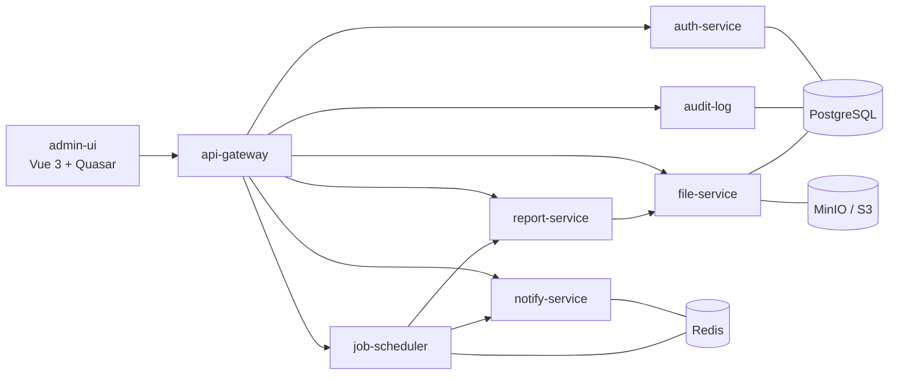

# backoffice-kit

Composable building blocks for enterprise back-office applications — authentication, RBAC,
audit logging, notifications, file storage, reports, scheduled jobs, an API gateway and a
Vue/Quasar admin dashboard — tested, documented, and runnable with one command.

> Status: under active development. See [ROADMAP.md](./ROADMAP.md) for progress.

## Architecture

Shared libraries used by every service: `core-config`, `core-logger`, `core-http`, `rbac`.

## Modules

| Repo | What it does |
|------|--------------|
| core-config | Typed, validated environment config (Zod) |
| core-logger | Structured logging with request context |
| core-http | Express app foundation: errors, validation, health, OpenAPI |
| auth-service | Users, roles, JWT (RS256 + JWKS), refresh rotation, service accounts |
| rbac | Permission middleware for any Express service |
| audit-log | Append-only audit trail with query + export |
| notify-service | Telegram / email / webhook notifications with retries |
| file-service | S3-compatible uploads with presigned URLs |
| report-service | Async PDF / Excel report generation |
| job-scheduler | Cron-style scheduled jobs with run history |
| api-gateway | Single entry point: routing, auth, rate limiting |
| admin-ui | Admin dashboard for everything above |
| docker-stack | One command to run the whole platform |
| observability | Prometheus, Grafana, Loki |
| e2e-tests | Playwright end-to-end tests |
| docs-site | Documentation and architecture decisions |

## How this project is built

Development is AI-assisted: an autonomous agent ([Hermes Agent](https://github.com/NousResearch/hermes-agent))
opens one pull request per day following [ROADMAP.md](./ROADMAP.md) and [CONVENTIONS.md](./CONVENTIONS.md).
Every change is reviewed, tested in CI, and merged by the maintainer. Architecture, scope and
review decisions are the maintainer's. The agent's daily notes are in [AGENT_LOG.md](./AGENT_LOG.md).

## Maintainer

**Mozes Markus Sapari** — [GitHub](https://github.com/MozesJr) · [Portfolio](https://mozesjr.github.io)

## License

MIT
